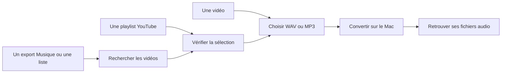
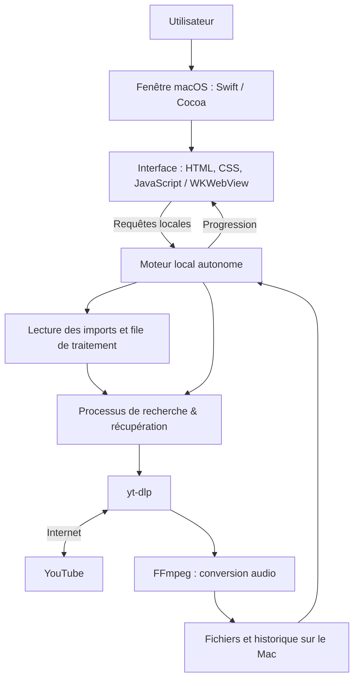

<div align="center">

# Sillage

### Le son, simplement. Sur ton Mac.

Transformez l’audio d’une vidéo YouTube en WAV ou MP3.<br>
Préparez une playlist entière ou retrouvez les vidéos d’une liste de titres.

**macOS · WAV & MP3 · Playlists · Conversion locale**

[Télécharger](#installation-facile-recommandée) · [Utiliser](#utilisation) · [Comprendre](#comment-fonctionne-sillage) · [Dépannage](#dépannage) · [Cadre d’utilisation](#cadre-juridique-et-utilisation-responsable)

</div>

---

## Présentation

Sillage est une application pour macOS qui réunit dans une même interface la récupération d’audio sur YouTube, sa conversion et son organisation sur le Mac.

Le projet est né d’un besoin concret autour de la musique et du DJing : disposer d’un outil simple pour préparer des fichiers audio, choisir leur format et traiter plusieurs titres sans répéter chaque manipulation à la main.

L’application fonctionne dans sa propre fenêtre Mac autonome. Les recherches et téléchargements nécessitent Internet ; la conversion est effectuée en local sur votre ordinateur. Aucun compte Sillage ni clé d’API n’est nécessaire.

> **À savoir avant de commencer**
>
> Sillage doit être utilisé uniquement lorsque le téléchargement et l’utilisation du contenu sont autorisés. La conversion en WAV ne transforme pas une source YouTube en enregistrement de qualité studio. Le [cadre d’utilisation](#cadre-juridique-et-utilisation-responsable) précise ces limites.

---

## Installation facile (Recommandée)

**Aucun outil de développement, Terminal ou connaissance technique n'est requis.**

### 1. Télécharger l'installeur

Téléchargez le fichier d'installation pour macOS (**`Sillage-Installer.dmg`**) depuis la section des versions :

👉 **[Télécharger la dernière version de Sillage (Releases)](https://github.com/Armand-mlr/sillage/releases)**

### 2. Installer l'application

1. Double-cliquez sur le fichier `.dmg` téléchargé pour l'ouvrir.
2. Dans la fenêtre qui s'affiche, faites glisser l'icône **Sillage** sur le raccourci du dossier **Applications**.
3. Éjectez l'image disque. Sillage est prêt dans votre dossier Applications.

### 3. Premier lancement (Sécurité macOS / Gatekeeper)

Comme Sillage est un projet open-source distribué hors du Mac App Store sans certificat payant Apple, macOS affiche un avertissement de sécurité au tout premier lancement.

**Pour ouvrir l'application la première fois :**

1. Ouvrez le dossier **Applications** dans le Finder.
2. Faites un **Clic droit** (ou `Contrôle` + Clic) sur **Sillage**.
3. Cliquez sur **Ouvrir** dans le menu contextuel.
4. Une boîte de dialogue apparaît : confirmez en cliquant sur **Ouvrir**.

> *Note : Cette validation manuelle n'est requise qu'une seule fois. Lors des utilisations suivantes, un double-clic ordinaire ou un lancement depuis Spotlight / le Launchpad fonctionnera directement.*

---

## Trois façons de préparer son audio

| Mode | Vous fournissez | Sillage prépare |
| :--- | :--- | :--- |
| **Vidéo** | Le lien d’une vidéo YouTube | Un fichier WAV ou MP3, avec écoute et enregistrement |
| **Playlist YouTube** | Le lien d’une playlist | Les fichiers sélectionnés, numérotés dans un dossier |
| **Import Musique** | Un export XML ou texte, ou une liste de titres | Des propositions YouTube à vérifier avant conversion |



### Ce que l’application propose

- Conversion d’une vidéo à l’unité, avec lecteur audio intégré.
- Préparation d’une playlist YouTube dans son ordre d’origine.
- Import de playlists exportées depuis **Musique sur Mac**, en XML ou texte.
- Saisie manuelle de titres, avec indication facultative de la version recherchée.
- Jusqu’à cinq propositions YouTube par titre ; possibilité de choisir une alternative ou de coller une URL précise.
- Choix du dossier de destination pour les imports dans la fenêtre native.
- Téléchargements séquentiels, suivi de progression, arrêt et reprise.
- Conservation des morceaux terminés lorsqu’un autre échoue.
- Historique local et bilan texte par import téléchargé.
- Interface française, apparence claire ou sombre suivant macOS, agrandissement jusqu’à 200 %.

### Ce que l’application ne fait pas

- Elle ne télécharge pas les fichiers audio d’Apple Music et ne se connecte pas à votre compte Apple.
- Elle ne contourne pas les DRM et ne propose pas de connexion pour accéder aux contenus YouTube privés ou restreints.
- Elle ne garantit pas que la première proposition corresponde à la bonne édition, au bon remix ou au bon enregistrement.
- Elle ne restaure pas la qualité perdue dans une source compressée.
- Elle ne fournit pas d’autorisation de téléchargement, de diffusion ou de réutilisation des œuvres.
- Elle n’est pas un logiciel de mixage, un éditeur audio ou un outil d’analyse BPM/tonalité.

---

## Utilisation

### Convertir une vidéo

1. Ouvrez l’onglet **Vidéo**.
2. Collez une URL YouTube dans le champ prévu.
3. Choisissez **WAV** ou **MP3**.
4. Lancez la conversion.
5. Écoutez le résultat, puis utilisez **Enregistrer** pour conserver une copie à l’emplacement souhaité.

Les liens classiques `youtube.com/watch`, `youtu.be`, YouTube Music et Shorts sont reconnus.

### Télécharger une playlist YouTube

1. Ouvrez **Playlist YouTube**.
2. Collez le lien de la playlist, puis cliquez sur **Lire la playlist**.
3. Vérifiez les vidéos proposées et décochez celles à exclure.
4. Choisissez le format et le dossier de destination.
5. Cliquez sur **Télécharger**.
6. Utilisez **Ouvrir le dossier** pour retrouver les fichiers et `Bilan Sillage.txt`.

Chaque import crée son propre sous-dossier numéroté selon l’ordre de la playlist ; les fichiers déjà présents ne sont pas écrasés.

### Importer une playlist de Musique sur Mac

L’export de playlist est une fonction intégrée à l'application Musique sur macOS. Il contient les **informations des titres**, pas leurs fichiers audio.

**Dans Musique :**
1. Sélectionnez une playlist dans la barre latérale.
2. Choisissez **Fichier → Bibliothèque → Exporter la playlist**.
3. Enregistrez-la en **XML**, ou au format texte.

**Dans Sillage :**
1. Ouvrez **Import Musique → Choisir un fichier…**.
2. Sélectionnez l’export.
3. Lancez **Rechercher sur YouTube**.
4. Vérifiez les correspondances et sélectionnez les titres à télécharger.
5. Choisissez le format, le dossier, puis lancez la conversion.

### Coller une liste de titres

Dans **Import Musique**, ouvrez **Ou coller une liste de titres**. Utilisez un morceau par ligne, avec le caractère `|` comme séparateur :

```text
Artiste | Titre
Autre artiste | Autre titre | Extended Mix
```

La troisième colonne est facultative (elle sert à préciser une version : remix, live, club edit...).

### Arrêter et reprendre

Le bouton **Arrêter l’import** interrompt l’opération sans supprimer les fichiers déjà terminés. Les imports sont conservés dans **Imports récents**. Vous pouvez reprendre un import inachevé à tout moment : les pistes déjà téléchargées seront automatiquement ignorées.

---

## WAV ou MP3 ?

| | WAV | MP3 |
| :--- | :--- | :--- |
| **Encodage** | PCM 16 bits | MP3 à 320 kb/s |
| **Usage courant** | Montage, édition, logiciels DJ | Écoute nomade, stockage réduit |
| **Compression supplémentaire** | Non, après décodage de la source | Oui (compression avec perte) |
| **Taille indicative** | ~ 10 à 12 Mo/min en stéréo | ~ 2,4 Mo/min |

**Le format de sortie ne change pas la qualité de la source d'origine.** Une source audio déjà compressée sur la plateforme restera limitée par celle-ci, même encapsulée dans un conteneur WAV.

---

## Comment fonctionne Sillage ?

L’application assemble une interface utilisateur, un serveur local et des outils spécialisés dans le traitement multimédia.



### Le trajet d’une conversion

1. L’interface transmet le lien et le format au moteur local.
2. Le moteur initialise la file de tâches.
3. **yt-dlp** récupère le flux audio source.
4. **FFmpeg** décode et encode le signal en WAV ou MP3.
5. Le fichier final est mis à disposition pour écoute et organisation dans vos dossiers.

---

<details>
<summary><strong>Section Développeur : Compiler depuis les sources</strong></summary>

Si vous souhaitez contribuer ou modifier le code source, vous pouvez compiler l'application manuellement.

### Prérequis
- macOS 13 ou ultérieur
- Python 3.10+
- Node.js 22+
- Command Line Tools Apple (`xcode-select --install`)

### Installation & Build
```sh
git clone https://github.com/Armand-mlr/sillage-mac.git
cd sillage-mac
chmod u+x "Construire Sillage.command"
zsh "Installer Sillage.command"
```

### Exécuter les tests
```sh
.venv/bin/python -m pip install -r requirements-dev.txt
.venv/bin/python -m unittest discover -s tests -v
```

</details>

---

<a id="dépannage"></a>
## Dépannage

| Problème rencontré | Solution |
| :--- | :--- |
| **« Développeur non vérifié » à l'ouverture** | Faites **Clic droit** sur Sillage $\rightarrow$ **Ouvrir**, puis validez avec le bouton **Ouvrir**. |
| **L'application refuse de s'ouvrir sur macOS** | Rendez-vous dans **Réglages Système** $\rightarrow$ **Confidentialité et sécurité**, puis cliquez sur **Ouvrir quand même** en bas de page. |
| **Échec lors de la recherche ou du téléchargement** | Vérifiez votre connexion Internet. Certaines vidéos soumises à restrictions d'âge ou supprimées ne peuvent pas être récupérées. |
| **Une mauvaise version ou remix est proposé** | Utilisez **Voir la vidéo**, sélectionnez une alternative proposée ou collez manuellement l'URL YouTube exacte. |
| **Espace disque insuffisant** | Les conversions WAV non compressées requièrent un espace disque conséquent. Vérifiez la place restante sur votre volume principal. |

---

## Cadre juridique et utilisation responsable

**Destination de l’outil.** Sillage est un outil technique de récupération et de conversion audio destiné à des usages licites. Il n’a pas pour objet d’encourager la contrefaçon, le téléchargement non autorisé ou le contournement de mesures de protection.

**Droits sur les contenus.** Il appartient à l’utilisateur de vérifier, avant chaque opération, qu’il dispose des droits ou autorisations nécessaires, ou qu’une exception légale est applicable. En droit français, la reproduction d’une œuvre requiert en principe l’accord des titulaires de droits ([article L. 122-4 du Code de la propriété intellectuelle](https://www.legifrance.gouv.fr/codes/article_lc/LEGIARTI000006278911)).

**Conditions des plateformes.** L’utilisateur doit respecter les [conditions d’utilisation de YouTube](https://www.youtube.com/static?template=terms&hl=fr&gl=FR).

**Absence d’affiliation.** Sillage n’est ni affilié à, ni approuvé par YouTube, Google ou Apple. Les marques citées appartiennent à leurs titulaires respectifs.
